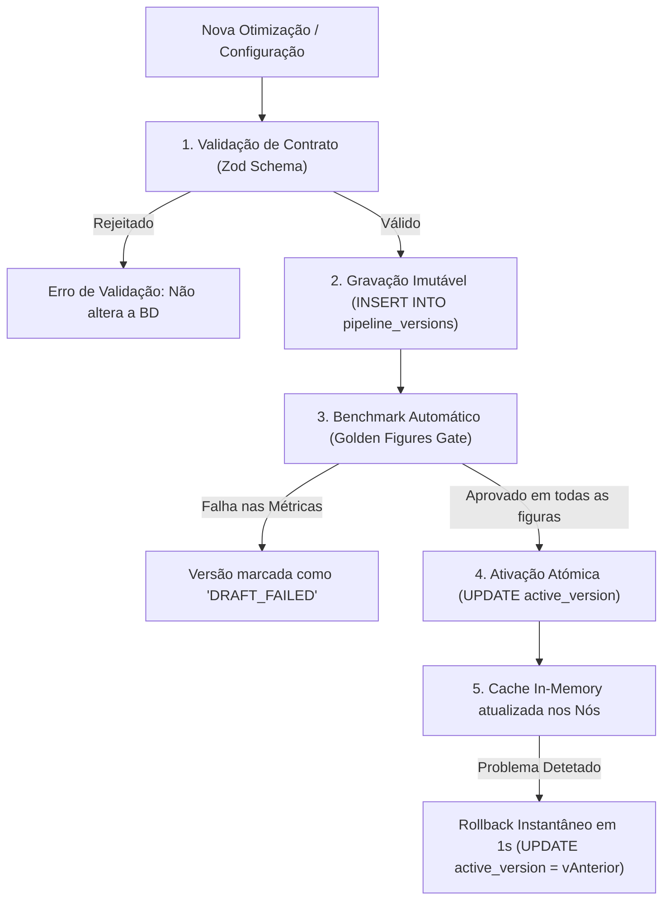

# Papikapi Generative Pipeline (`papikapi-api`)

Deterministic generative pipeline that turns a text prompt and optional reference photos into an axonometric papercraft design (Stage 1), cuts it out and synthesizes a production-ready 3D model (Stage 2), simplifies geometry while preserving pristine 90° boxy edges and full-resolution texture atlases (Stage 3), unfolds the figure into printable A4 sheets (Stage 4), and compiles a 3D assembly animation plan (Stage 5).

---

## 🏛️ Architecture Overview

The pipeline is implemented entirely in strict **TypeScript (`.ts`)** under Node 24 with `tsx`, using Blender headless only for geometry processing (unfolding, plinth fusion, and planar decimation).

```text
apps/papikapi-api/
├── resources/                    # Development working area (media-only)
│   ├── papikapi.db               # SQLite Single Source of Truth (WAL mode)
│   └── [model]/
│       ├── stage-1/              # step-1-alternatives.jpeg, step-2-art.jpeg, step-3-upscaled.webp
│       ├── stage-2/              # step-1-art-cutout.webp, step-2-3d.glb, step-2-preview.webp
│       ├── stage-3/              # step-1-simplify.glb, step-2-atlas-trellis.webp, step-3-atlas.webp, step-4-texturize.glb, step-5-plinth.glb
│       └── stage-4/              # step-1-net.json
├── public/
│   └── models/                   # Public media assets served by NestJS & CDN
│       └── [model]/
│           ├── art.jpeg          # Chosen 2D reference art
│           ├── alternatives.jpeg # 3x2 alternatives grid
│           ├── model.glb         # High-res textured 3D model with plinth (three.js)
│           └── sheets.pdf        # Multi-page A4 PDF assembly booklet
├── src/                          # NestJS REST API application
│   ├── database/                 # Drizzle ORM schema & SQLite provider
│   ├── generator/                # Generation SSE progress & trigger service
│   ├── manifests/                # Figure manifests: steps, runs, costs, times, estimates
│   └── models/                   # Model catalogue, meshes, and dynamic assembly plans
└── scripts/
    ├── stage-1/                  # Alternatives (FLUX.2), Pick, Upscale (Real-ESRGAN)
    ├── stage-2/                  # TRELLIS input (SAM + ViTMatte), 3D Synthesis (TRELLIS.2)
    ├── stage-3/                  # Simplify, TRELLIS atlas, Atlas with art eyes, Texturize, Plinth, Previews
    ├── stage-4/                  # Papercraft Unfolding (2D net), A4 PDF Sheets Booklet
    ├── stage-5/                  # Assembly Animation Plan & Tree
    └── shared/                   # everything the stages share
        ├── cli/                  # stage-orchestrator.ts (unified runner), publish-figures.ts
        ├── common/               # pipeline config, manifests, cleaners, reporters, Blender helpers
        ├── server/               # creator service used by the NestJS API
        ├── runpod/               # TRELLIS and FLUX serverless workers
        ├── migrations/           # one-off data migrations
        ├── training/             # LoRA training material
        ├── docker/               # container build helpers
        └── scratch/              # local debugging and experiments, never committed (gitignored)
```

---

## 🗄️ Database-First Architecture (Zero JSON on Disk)

All manifests, assembly plans, prompts, picks, execution times, and compute costs reside **exclusively in SQLite (`resources/papikapi.db`)**.

### Strict Filesystem Rule
* The filesystem in `resources/` and `public/models/` contains **strictly media files only**: `.glb`, `.jpeg`, `.webp` (lossless for working images, so cutouts and atlases keep every pixel) and `.pdf`. Only short-lived files inside temporary folders stay PNG (SAM masks have more channels than WebP holds).
* No `.json` manifests (`manifest.json`, `*-manifest.json`, `assembly.json`, `index.json`) and no `prompt.txt` exist on disk.
* Intermediate files generated during stage execution are purged upon completion by `OutputCleaner.purgeNonMediaFiles()`.

### SQLite Schema (`resources/papikapi.db`)

1. **`models`**:
   * `id`: Short random figure id, 8 lowercase letters and digits (e.g. `k7f2p9qx`). Names every folder (`resources/<id>`, `public/models/<id>`) and every URL. It carries no meaning.
   * `subject`: English subject used to pick the style reference image (e.g. `lion`, `pink-pig`).
   * `display_name_pt` & `display_name_en`: Name shown to the user, without articles, possessives, "cute"/"fofo" or intensity adverbs (e.g. `Porco cor-de-rosa` / `Pink pig`). Built by the app with `figureDisplayName` from `@ibid/utils`.
   * `prompt`: User prompt text.
   * `flux_prompt`: Enriched prompt with style LoRA and physical papercraft rules.
   * `status`: Lifecycle state (`DONE`, `RUNNING`, `FAILED`).
   * `chosen_pick`: Selected variation index (`1..6`).
   * `total_seconds` & `total_cost_usd`: Aggregated runtime and RunPod GPU spend.
   * `assembly_plan`: Complete JSON assembly document containing fold trees, hinges, 3D polygons, and tray coordinates.
   * `created_at` & `updated_at`: ISO-8601 timestamps.

2. **`model_stages`**:
   * `id`: Compound key (`model_id-stage_id`).
   * `model_id`: Foreign key to `models.id` (ON DELETE CASCADE).
   * `stage_id`: Step identifier (e.g. `s1-step-1`, `s3-step-1`, `s5-step-1`).
   * `status`, `seconds`, `cost_usd`, `cost_note`.
   * `metrics`: Step-specific validation metrics (face counts, watertight status, deviations).
   * `data`: Execution parameters, seeds, camera poses, and model paths.

3. **`model_files`**:
   * Tracks registered binary media assets (`art.jpeg`, `model.glb`, `sheets.pdf`) with file sizes and MIME types.

---

## ⚙️ The 5 Canonical Stages

### Stage 1: Art Alternatives & 3D Input Preparation
* **`s1-step-1` (ALTERNATIVES)**: `scripts/stage-1/step-1-alternatives.ts`
  * Generates a 3x2 grid (6 style variations) from childlike/chibi to mature papercraft on a neutral `#E5E5E5` backdrop using `black-forest-labs/FLUX.2-klein-4B` with the studio style LoRA on RunPod Serverless.
  * The plane colour is chosen in code (`plane-colour.ts`), never by FLUX, which, left to pick from a list, falls back on lilac and blue, often the colour of the paws. The figure's colours come from its first reference (the pixels unlike the image border, its lowest part counting as feet), else from the colour words of the prompt; the plane is the `plane_palette` colour furthest from the feet in Lab. FLUX gets that one colour and a sheet exactly as wide and long as the figure's footprint, like the plinth (`{plane_colour}` in the system prompt); the colour is kept in the step manifest (`planeColour`).
* **`s1-step-2` (PICK)**: `scripts/stage-1/step-2-pick.ts`
  * Crops the chosen cell (`1..6`) at high resolution to `resources/<model>/stage-1/step-2-art.jpeg` and `public/models/<model>/art.jpeg`.
* **`s1-step-3` (UPSCALE)**: `scripts/stage-1/step-3-upscale.ts`
  * Enlarges the chosen art 4x with Real-ESRGAN (`realesrgan-x4plus-anime`) to `resources/<model>/stage-1/step-3-upscaled.webp`.

### Stage 2: TRELLIS
Stage 2 is only the TRELLIS result: nothing changes the model TRELLIS returns.
* **`s2-step-1` (TRELLIS INPUT)**: `scripts/stage-2/step-1-trellis-input.ts`
  * Cuts the figure out of the upscaled art by its shape (SAM for the plane and the figure, ViTMatte for the edges) and centres it on a 1024 px canvas (`step-1-art-cutout.webp`).
  * SAM is prompted with a point on every coloured or white part off the plane (`figure_matte.py`), so white legs on a coloured sheet stay with a pale body.
  * Patches of the seamless background wall that SAM glues to the outline are taken out when they reach the outline's edge (`plane_mask.background_wall`); a support post standing on the paper and holding the figure comes back in, and thin threads (paper edges) are cut off (`supports.py`). Regions inside the figure that are not fully opaque (white markings, pale insides of ears, catchlights) are made opaque again unless they are large gaps (`holes.py`).
* **`s2-step-2` (TRELLIS)**: `scripts/stage-2/step-2-trellis.ts`
  * Runs TRELLIS.2 with the official Space settings (1024 cascade, 500 000 faces, 2048 texture) on RunPod Serverless (`step-2-3d.glb`, `step-2-preview.webp`).
  * Quality gate (`python/trellis_gate.py`): the model's silhouette through the recovered art camera must cover the art (`overlap_min`) and the model must be one solid piece (`parts_max`). A failing model is rebuilt with a new seed, up to `max_attempts`; the best one is kept and every seed's verdict is recorded.

### Stage 3: Simplification, Texture Atlas & Papercraft Plinth
* **`s3-step-1` (SIMPLIFY)**: `scripts/stage-3/step-1-simplify.ts`
  * Blocky figures are fitted with boxes; when the boxes miss the gates the figure falls back to the planar mode.
  * Planar mode fills the TRELLIS figure with voxels from the outside in (inner walls included), builds the closed shell of that solid and pulls every shell vertex onto the TRELLIS surface (`solid_shell.py`), then decimates it to the fewest faces that keep volume and size within `planar_max_change_percent`.
  * The result is always watertight (`openEdges == 0`).
  * Eyes are printed, never sculpted: the eyes are located (see Eyes below) and every vertex over an eye is pressed onto the plane of the face around it (`eye_flattening.py`).
* **`s3-step-2` (TRELLIS ATLAS)**: `scripts/stage-3/step-2-trellis-atlas.ts`
  * Saves the TRELLIS texture exactly as TRELLIS made it (`extract_trellis_atlas.py`, `step-2-atlas-trellis.webp`), so the details pasted in the next step can be compared with the original.
* **`s3-step-3` (ATLAS)**: `scripts/stage-3/step-3-atlas.ts`
  * Every figure first gets the art's colours (`colour_calibration.py`): the TRELLIS base colour seen through the art camera is gathered with the art's, on flat areas only (both images agree on one colour there, so a slight misalignment never pairs a spot with fur). The art is lit and TRELLIS is not, so only what light cannot do is corrected, on linear colour: one gain per channel read from the colour proportions (a white balance, within `channel_gain_range`) and one exposure read from the lit faces (`exposure_quantile`, within `exposure_range`). Neutral paper takes the white balance only in proportion to its saturation (`neutral_saturation`), so whites stay white. Black stays black and patterns stay as TRELLIS drew them.
  * Erases each TRELLIS eye on the TRELLIS atlas and, once the colours are copied onto the simplified faces, pastes the FLUX art eye on those faces, as the art camera sees them (`eye_paste.py`): a fold beside the eye (a pug's muzzle) never drags part of it across. Texels on the TRELLIS eye (its core, the art eye's footprint and the iris or rim around them within `eye_rim_ratio`) take the colour of the nearest skin texel (copied, never blurred); texels under the art eye, centred on the TRELLIS eye and scaled to it, take the art pixel as it is. A dark area that runs on out of that rim (a muzzle, a raccoon's mask) is a feature of the face and stays. Only texels the eye's camera sees are written (`eye_seen_depth_ratio`), so a surface near the eye but hidden from it (the side of a muzzle) never gets a second copy of the eye.
  * Copies that atlas onto the simplified faces, texel by texel (`bake_atlas.py`, `surface_transfer.py`, `step-3-atlas.webp`). Each texel takes the first outward-facing TRELLIS surface seen from outside along its face normal, so the inner walls of TRELLIS never leak their colour in. No colour is changed.
  * Every UV island gets a 4 px border of its own edge colours (`atlas_padding.py`), so folds show no dark seam line.
* **Eyes**, shared by steps 1 and 3:
  * `python/find_art_eye.py` and `python/art_eye.py` (OpenCV) find the eyes drawn on the art cutout: a white catchlight on a dark pupil (a rule of the stage-1 prompt), grown through the iris and the rim, at least `eye_area_min_ratio` of the figure and round enough (`eye_roundness_min`, oval cartoon eyes pass). A ring whose colour runs on further than `rim_reach_ratio` pupil radii (Sonic's large white eye area) is not part of the eye. A pair of twin eyes (like size and colour) is taken when the art shows both; else the biggest eye.
  * `blender/eyes/art_camera.py` lists the views whose TRELLIS silhouette covers the art silhouette almost as well as the best; `camera_choice.py` keeps the one from which the TRELLIS colours look most like the art (a blocky figure has the same silhouette front and back).
  * `blender/eyes/eye_locator.py`, `eye_view.py` and `eye_match.py` see the TRELLIS figure through that camera around each art eye (through the camera mirrored by `symmetry.py` for an eye the art hides), find the TRELLIS eye by matching the art eye against it (a match loses score with its distance from where the camera puts the eye, `eye_match_distance_penalty`, so a dark muzzle never wins), and take the centroid and size of the TRELLIS eye's own pixels as the place and size of the pasted eye. No match, or a region that is not eye sized, keeps the TRELLIS eye.
* **`s3-step-4` (TEXTURIZE)**: `scripts/stage-3/step-4-texturize.ts`
  * Applies `step-3-atlas.webp` to the simplified figure (`step-4-texturize.glb`).
* **`s3-step-5` (PLINTH)**: `scripts/stage-3/step-5-plinth.ts`
  * Runs `build_plinth.py`: constructs a white trapezoidal papercraft plinth under the feet, fusing it into an airtight mesh (`step-5-plinth.glb`).
* **`s3-step-6` (PREVIEWS)**: `scripts/stage-3/step-6-previews.ts`
  * Renders the textured and wireframe previews into `public/models/<model>/` as WebP, from the art's own view, under a soft studio light (`studio_light`): under flat light a part of the same colour as the face behind it (a pig's snout) vanishes.

### Figure review report
* After every pipeline run the orchestrator rewrites `resources/figures-report.pdf` (`scripts/shared/report/`): the average time and cost of every step, the real spend, and each figure's FLUX art, TRELLIS render and final paper figure. `npx nx run papikapi-api:report` writes it on demand. It is rendered by the installed Google Chrome, headless.

### Stage 4: Papercraft Unfolding & Booklet Export
* **`s4-step-1` (UNFOLD)**: `scripts/stage-4/step-1-unfold.ts`
  * Runs `unfold_model.py` in Blender headless: scales longest dimension to `target_size_mm` (300 mm) and computes the 2D net pieces, cuts, mountain/valley fold lines, and glue tabs.
* **`s4-step-2` (SHEETS)**: `scripts/stage-4/step-2-sheets.ts`
  * Packs unfolded pieces onto A4 sheets, renders isometric 3D step-by-step assembly diagrams, and exports the high-resolution printable PDF guide to `public/models/<model>/sheets.pdf`.

### Stage 5: 3D Assembly Animation Plan
* **`s5-step-1` (ASSEMBLY)**: `scripts/stage-5/step-1-assembly.ts`
  * Pure TypeScript engine ($0.00, ~0.6 s per model).
  * Computes a spanning fold tree from the largest facet of each piece, bottom-up assembly sequence (`AssemblyOrder`), flat tray layout coordinates (`TrayLayout`), and stack-safe face color assignment (`FaceColourAssigner`).
  * Stores the full assembly plan in SQLite (`models.assembly_plan`). Consumed dynamically by the frontend at `/models/:id/assembly.json`.

---

## 🛡️ Sistema de Regressão Imediata e Otimização Segura

Para permitir que a configuração do pipeline (`pipeline.json`) seja transferida para a base de dados e receba otimizações sem riscos de regressão em produção, o sistema segue **5 Pilares de Segurança**:



### 1. Imutabilidade e Versionamento Semântico
* Configurações nunca são sobrescritas destrutivamente. Cada alteração recebe um novo identificador SemVer (`v1.0.0`, `v1.1.0`, etc.) na tabela `pipeline_versions`.
* Cada figura na tabela `models` regista a `pipeline_version` exata com que foi gerada, garantindo total reprodutibilidade histórica.

### 2. Validação Estrita por Schema (Zod Guard)
* Nenhuma configuração entra na base de dados sem passar por validação estrita de tipos e intervalos:
  - Dimensões, números de colunas/linhas, limites de compactação e tolerâncias angulares.
  - Presença obrigatória de tags de interpolação nos prompts (`{plane_colour}`).

### 3. Rollback Instantâneo em 1 Segundo
* Caso uma nova otimização de parâmetros apresente comportamento indesejado em casos reais, o rollback não requer redeploy de código nem reinício de contentores:
  ```sql
  UPDATE system_settings SET value = 'v1.0.0' WHERE key = 'active_pipeline_version';
  ```
  Todos os processos e requisições voltam imediatamente à versão estável anterior.

### 4. Portão de Regressão Automático ("Golden Figures Benchmark")
* Antes de uma versão ser ativada (`active = 1`), o runner de regressão executa testes contra as **figuras canónicas de controlo**:
  - **Alex:** Validação de quinas retas a 90°, sem chanfrados, folga entre pernas e atlas 2048x2048.
  - **Mario:** Validação de curvatura orgânica, dobras e cores de alta densidade.
  - **Creeper:** Validação de padrões de textura pixelizada e proporções.
  - **Pikachu & Sonic:** Validação de membros finos e partes curvas.
* Se qualquer figura falhar as métricas de qualidade (`watertight == true`, `openEdges == 0`, `volumeDeviation < 15%`), a versão é recusada.

### 5. Sincronização e Distribuição Atómica
* Ao iniciar, o `papikapi-api` verifica a integridade da versão ativa na base de dados SQLite (`papikapi.db`).
* Alterações podem ser sincronizadas via endpoint administrativo assinado (`POST /api/v1/system/pipeline-sync`), atualizando os parâmetros em tempo real.

---

## 🚀 Execution & API Usage

### Running the Pipeline CLI

```bash
# Executar a pipeline completa para um modelo (ex: Alex)
npx tsx scripts/shared/cli/stage-orchestrator.ts --model alex

# Executar a partir de um estágio específico (ex: Stage 3 em diante)
npx tsx scripts/shared/cli/stage-orchestrator.ts --model alex --from-step s3-step-1 --pick 1

# Executar apenas um estágio isolado
npx tsx scripts/shared/cli/stage-orchestrator.ts --model alex --stage 3

# Reconstruir e verificar compilação TypeScript
npm run build
```

### Running the Containerized API (Docker)

```bash
# Iniciar a API com montagem dos volumes de media e SQLite
docker compose up -d --build

# Verificação de logs
docker logs -f papikapi-api
```

A API fica disponível nas seguintes portas:
* **Porta 4505:** REST API e documentação Swagger (`http://localhost:4505/api/docs`).
* **Porta 4500 & 4502:** Mapeadas diretamente para o contentor para compatibilidade total com o `papikapi` e ferramentas satélite.

### Principais Endpoints da API

* `GET /api/v1/models`: Lista o catálogo de modelos com miniaturas a partir da base de dados.
* `GET /models/:id/assembly.json`: Serve dinamicamente o plano de montagem a partir de `models.assembly_plan`.
* `GET /api/v1/models/:id/mesh`: Faz streaming binário do `model.glb`.
* `GET /api/v1/models/:id/sheet`: Faz streaming binário do PDF `sheets.pdf`.
* `POST /api/creator/generate`: Desencadeia a geração de alternativas (FLUX.2).
* `POST /api/creator/pick`: Seleciona a variação e avança na síntese 3D.
* `GET /api/creator/progress?name=:name`: Server-Sent Events (SSE) com progresso em tempo real.
* `GET /api/v1/manifests`: Lista das figuras com estado, tempo, custo e datas, com pesquisa (código, nome, assunto, prompt), filtros por estado e datas, ordenação e paginação.
* `GET /api/v1/manifests/:id`: Manifesto completo de uma figura: cada passo pela ordem da pipeline, cada execução (`step_runs`), totais, datas e ficheiros publicados.
* `GET /api/v1/manifests/summary?figures=N`: Tempo e custo médios por passo e por figura, estimativa para N figuras e gasto real por dia.
